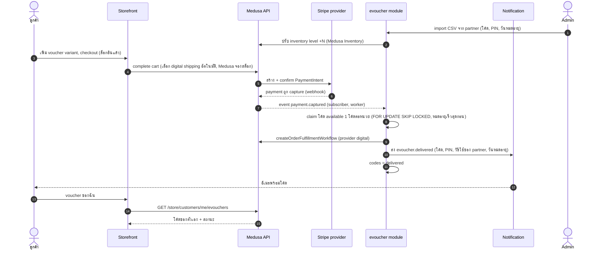
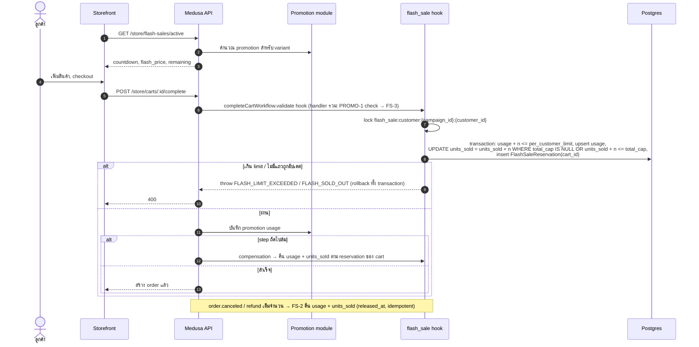
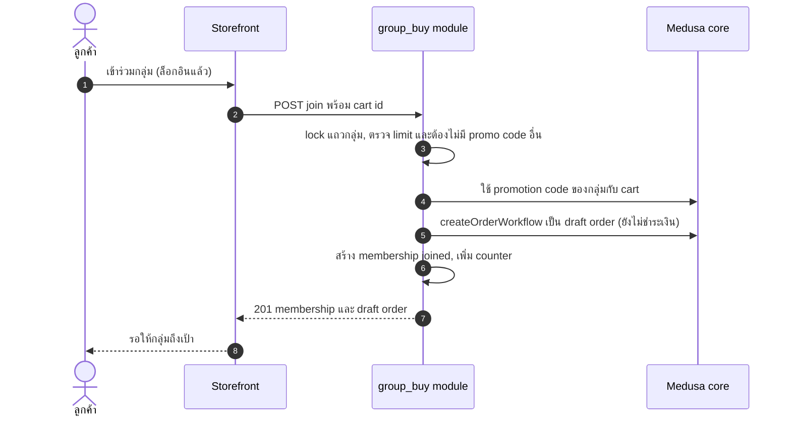
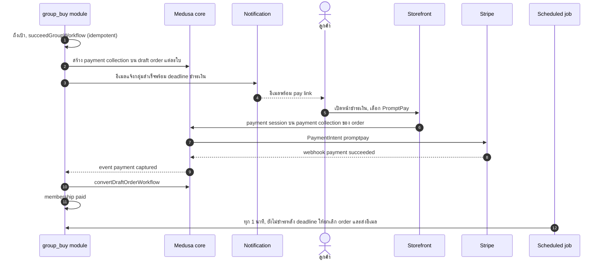
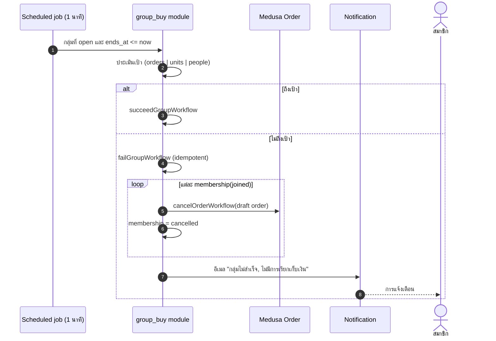
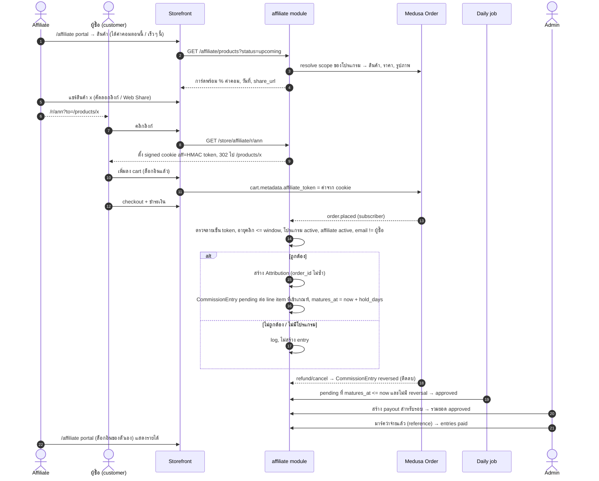
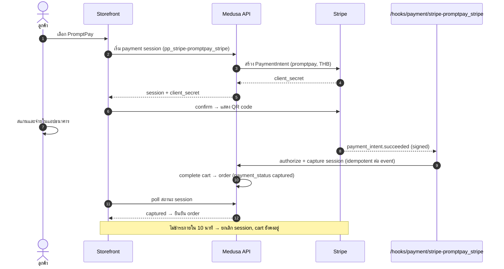

# Sequence diagrams

participant ที่ชื่อลงท้ายด้วย 'module' คือ module ที่เราสร้างเอง ส่วนที่เหลือเป็นของ Medusa หรือ Stripe

## E-voucher: import โค้ด partner → ซื้อ → จัดสรร → ส่งอีเมล

## Flash sale: checkout ภายใต้ limit

## Group buy 1/2: join (draft order)

## Group buy 2/2: ถึงเป้า, ชำระเงิน

## Group buy: ไม่ถึงเป้า

## Affiliate: โชว์สินค้า → แชร์ → คลิก → สั่งซื้อ → ค่าคอม → จ่าย

## Payment: PromptPay ผ่าน Stripe + webhook

