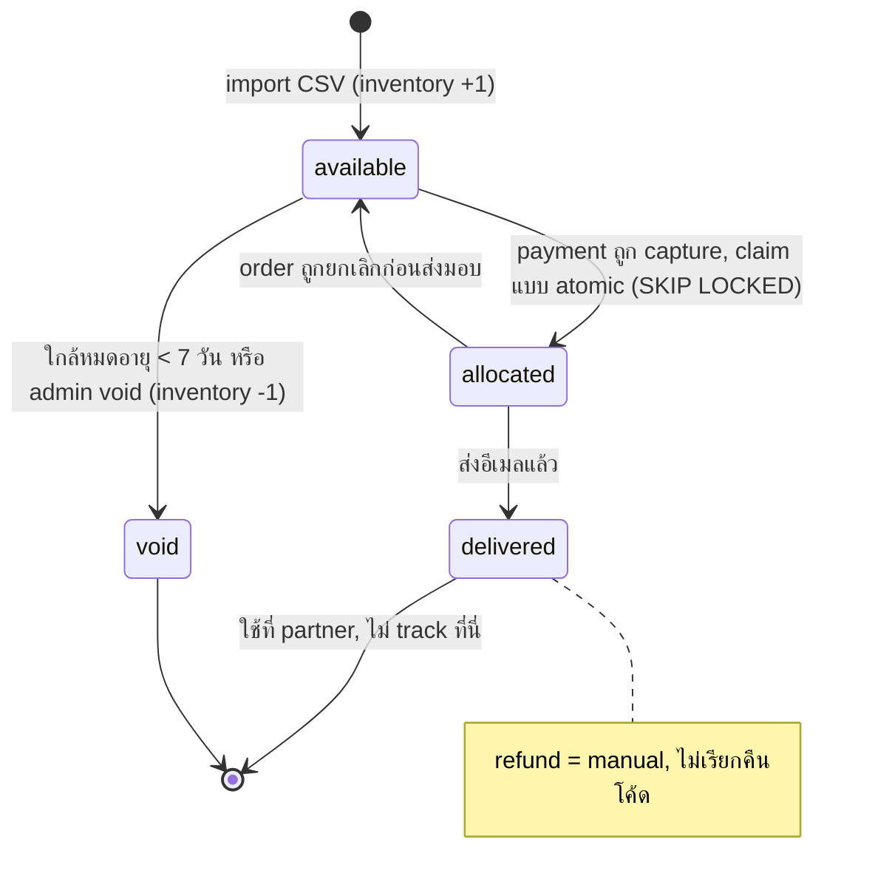
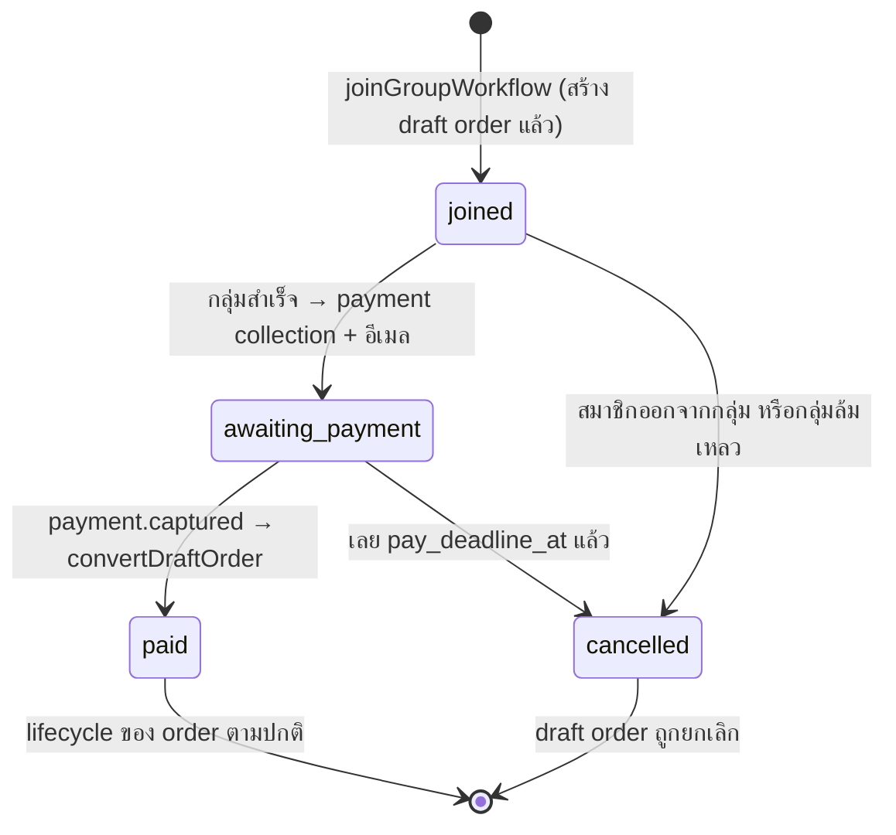
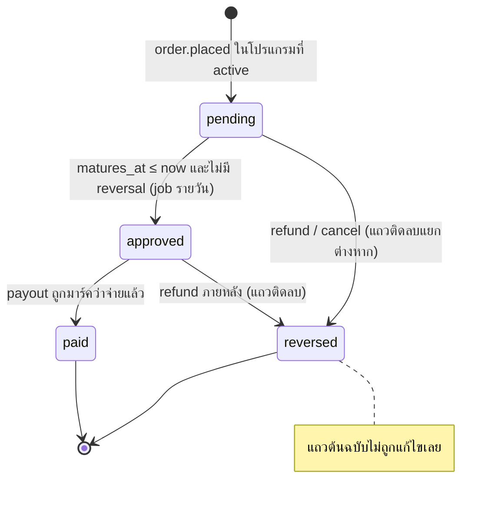
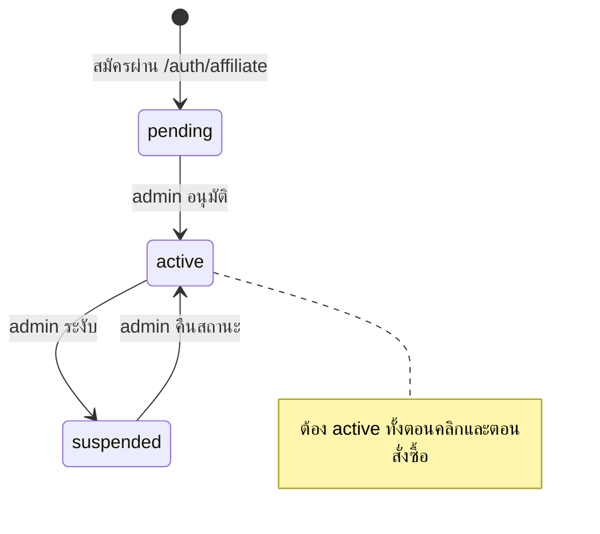
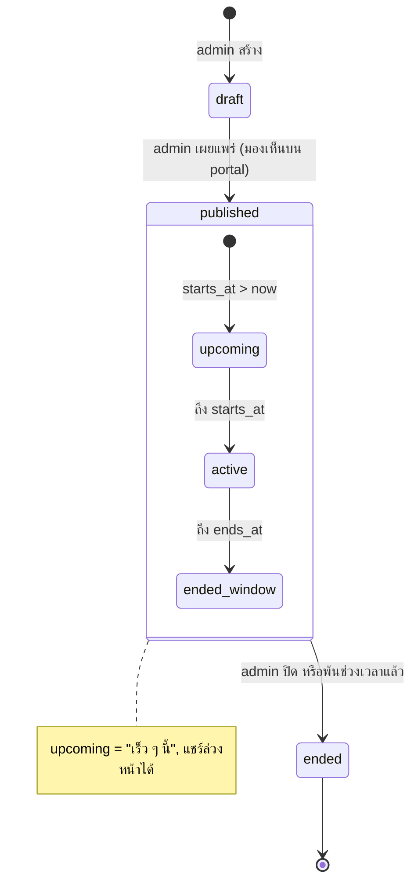
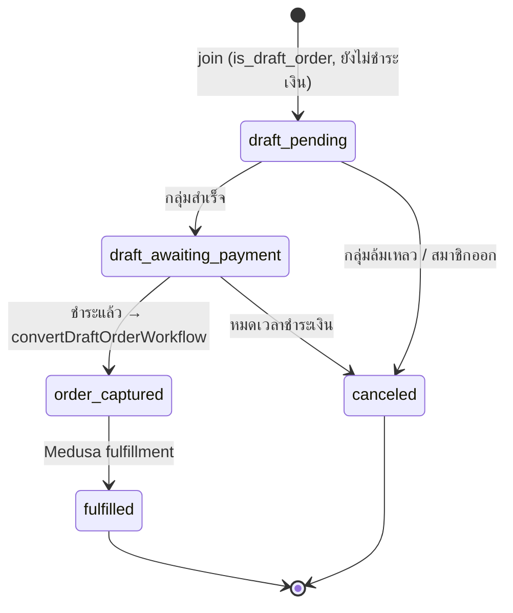

# State machines

ทุก transition ถูก implement เป็น workflow step ที่ idempotent หรือการอัปเดตแบบ atomic

## EvoucherCode

## GroupBuyGroup

## GroupBuyMembership

## CommissionEntry (ledger)

## Affiliate

## AffiliateProgram (การมองเห็น)

## Order (มุมมอง group-buy)

