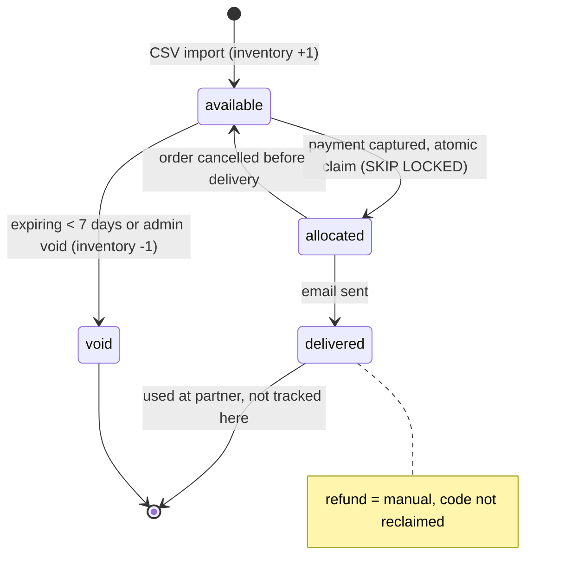
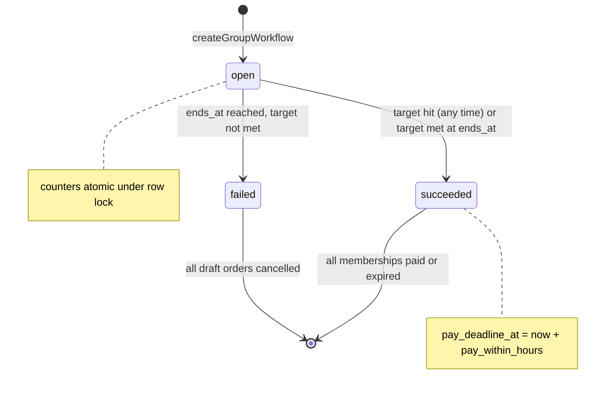
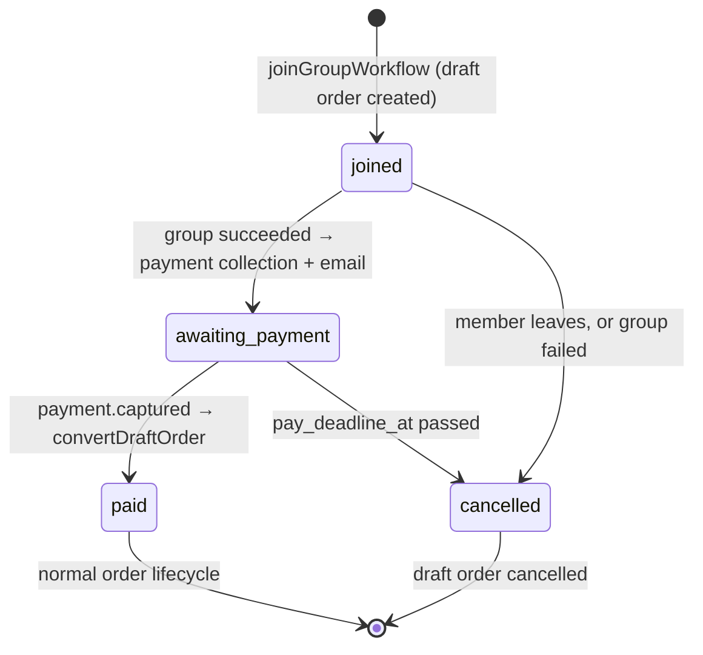
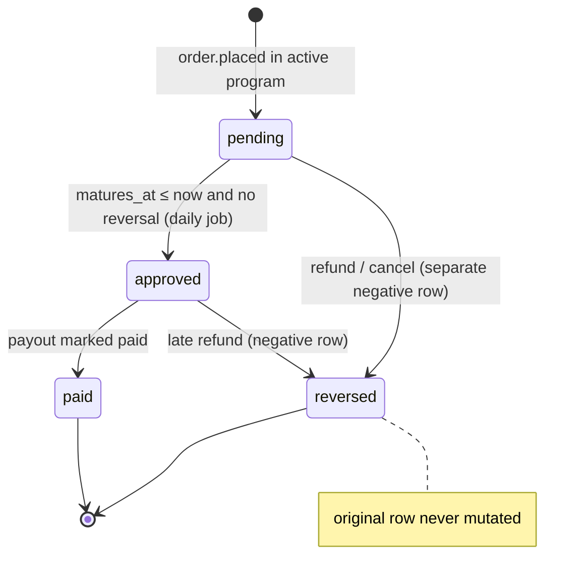
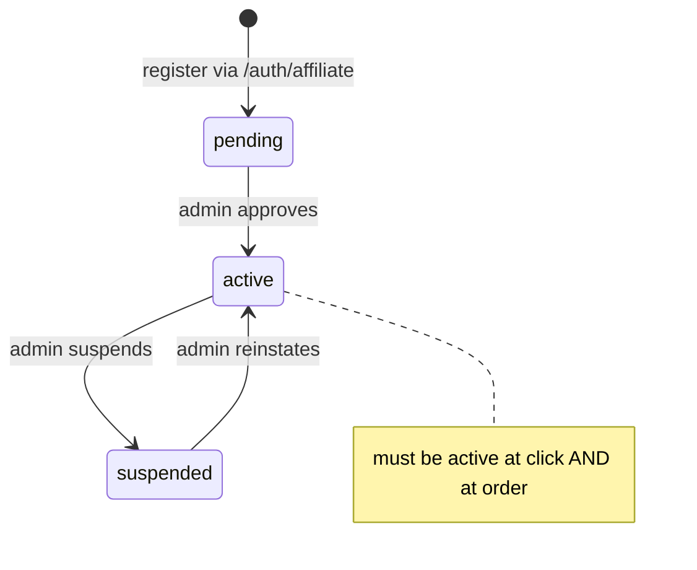
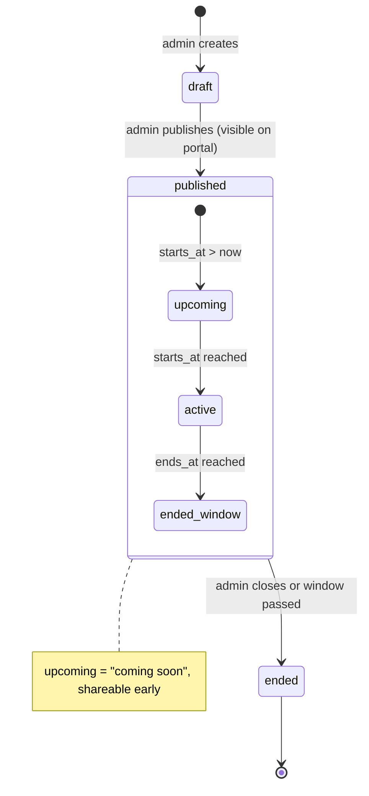
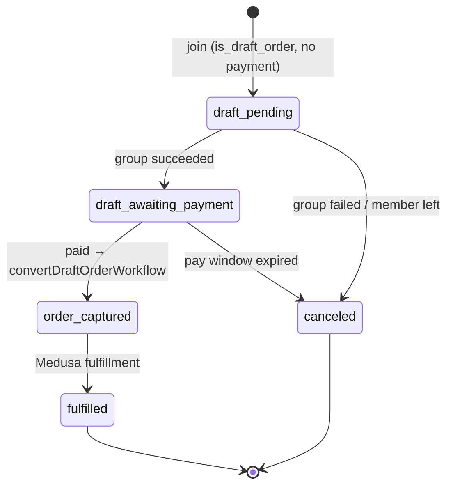

# State machines

Every transition is implemented as an idempotent workflow step or atomic update.

## EvoucherCode

## GroupBuyGroup

## GroupBuyMembership

## CommissionEntry (ledger)

## Affiliate

## AffiliateProgram (visibility)

## Order (group-buy view)

